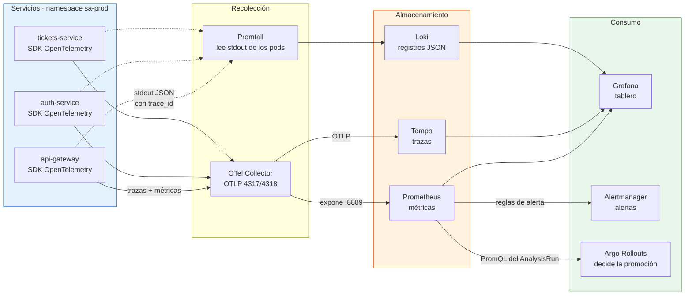
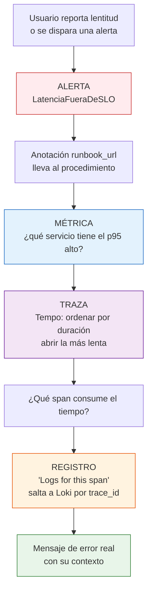
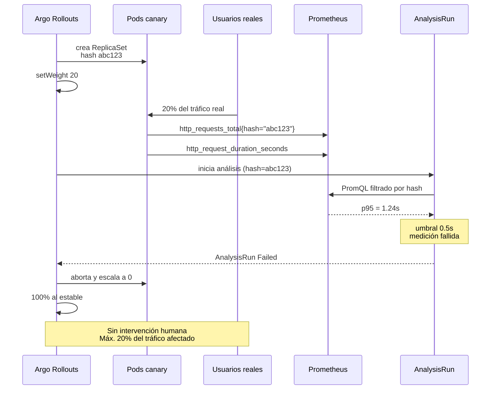
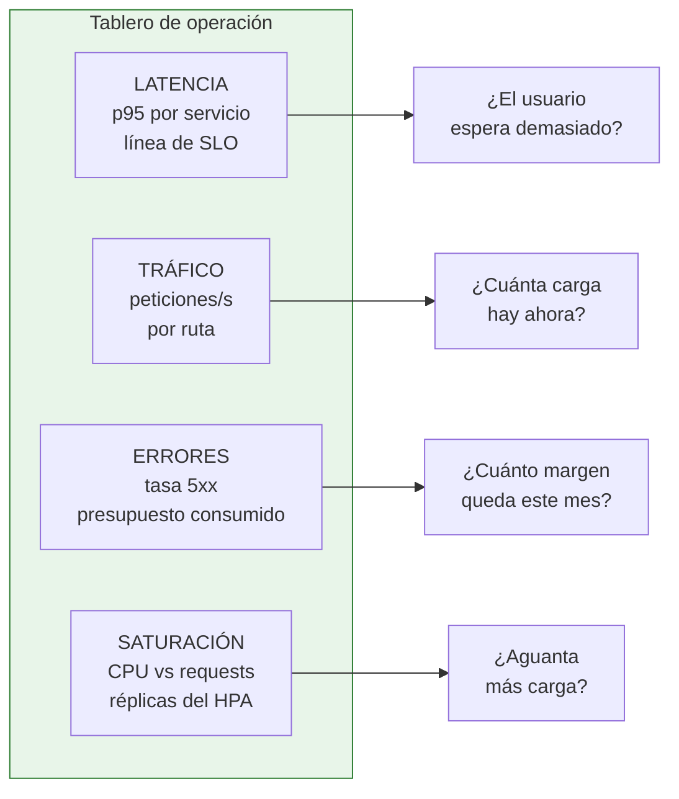

# Diagrama del flujo de telemetría

## 1. De la señal al tablero y a la alerta

El detalle que importa: **Prometheus alimenta a Argo Rollouts**. Esa flecha
es la diferencia con la Práctica 8, donde la promoción la decidía un Job
con `curl` que no medía tráfico real.

---

## 2. El recorrido del síntoma a la causa

Sin correlación, el paso de E a G obliga a revisar los registros servicio
por servicio adivinando cuál falló. Con el `trace_id` en cada línea JSON,
es un clic.

---

## 3. Qué gobierna la promoción del canary

El filtro por `rollouts_pod_template_hash` es lo que permite medir **solo**
el canary. Sin él, con el canary al 20 %, una versión que fallara por
completo movería el promedio global apenas al 20 % de error — por debajo
del umbral. El defecto pasaría.

---

## 4. Los cuatro señales de oro en el tablero

Cada panel responde una pregunta concreta de operación. El tablero no
muestra todas las métricas disponibles: muestra las cuatro que deciden si
hay que intervenir.
